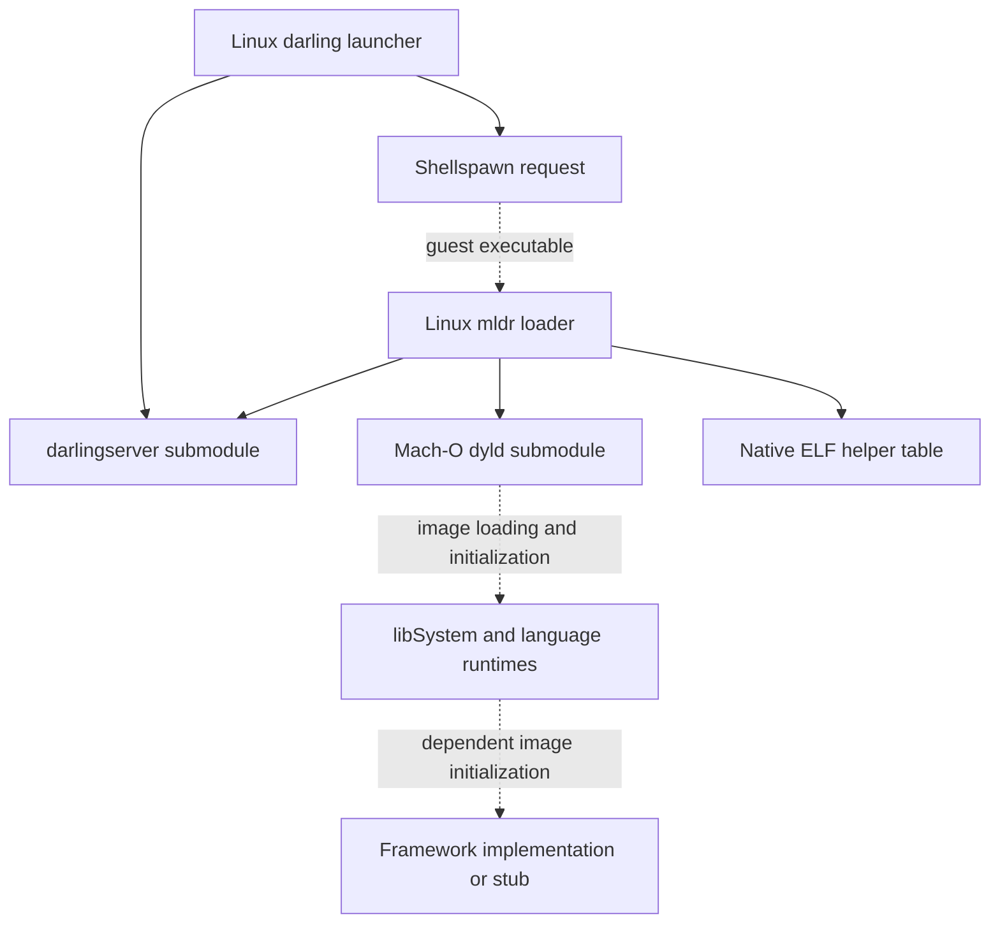

# P001 source and runtime map

## What this evidence establishes

This is a **static source inspection**, dated 2026-10-31, of integration commit [`b25035fce2cd1c038c567d34ea0797371947d95d`](https://github.com/boop-bip80/MAC-OS-EMULATION/tree/b25035fce2cd1c038c567d34ea0797371947d95d). The audited implementation baseline is [`3447ff5ab8e837ea54a13a506c60d34d77e2bd15`](https://github.com/boop-bip80/MAC-OS-EMULATION/tree/3447ff5ab8e837ea54a13a506c60d34d77e2bd15); the integration commit replaces its README with the phased plan. The prior README remains available at its [immutable source location](https://github.com/boop-bip80/MAC-OS-EMULATION/blob/3447ff5ab8e837ea54a13a506c60d34d77e2bd15/README.md).

The companion [classification register](../../../tools/compat/logic-pro/classifications.json) contains 32 source excerpts with immutable blob IDs, exact line ranges, SHA-256 hashes of the excerpt bytes, required text, and the reasoning behind each classification. Source bytes were retrieved using the GitHub integration at the pinned integration commit and their Git blob SHA-1 identifiers were independently recomputed locally. The phase verifier repeats the checks against actual Git objects; it must reject missing, changed, or truncated evidence.

**No Darling runtime, Mach-O application, Logic binary, audio callback, MIDI client, graphics window, or ARM instruction translation was executed for this map.** The inventory and recovery results are separate P001 evidence. Neither a classification match nor a clean checkout qualifies application compatibility.

The map is intentionally a curated inspection of critical ownership and behavior boundaries, not an exhaustive function census. `implemented_body_unqualified` means that a source body performs work; it does not mean that its ABI, numerical result, error handling, concurrency, or supported inputs have passed tests. The recorded host and tool versions belong in [inventory.json](evidence/P001/inventory.json), so source architecture claims cannot be confused with an execution host's CPU.

## Launch path and ownership boundaries

The following diagram describes relationships visible in the source. Dashed edges represent an expected continuation through submodule-owned runtime behavior that this parent-source map has not executed or fully inspected.

1. **The Linux launcher sets up the process environment.** `src/startup/CMakeLists.txt` builds `darling` as a native executable and requests setuid installation. In `spawnInitProcess`, the launcher calls `unshare`, forks, and executes `darlingserver` with the prefix and user/group information. This explains why a restricted build container is not automatically a suitable runtime test host. The phase does not change privileges or claim successful namespace creation. See [launcher build, lines 17–28](https://github.com/boop-bip80/MAC-OS-EMULATION/blob/b25035fce2cd1c038c567d34ea0797371947d95d/src/startup/CMakeLists.txt#L17-L28) and [server launch, lines 780–824](https://github.com/boop-bip80/MAC-OS-EMULATION/blob/b25035fce2cd1c038c567d34ea0797371947d95d/src/startup/darling.c#L780-L824). The launcher also connects to shellspawn in the prefix; the subsequent guest process path requires the server, shellspawn and execution machinery to work together, which is not demonstrated here. See [shellspawn connection](https://github.com/boop-bip80/MAC-OS-EMULATION/blob/b25035fce2cd1c038c567d34ea0797371947d95d/src/startup/darling.c#L555-L578).

2. **`mldr` bridges native Linux execution to a Mach-O image.** It is built as a host executable with `libdl`, realtime/native libraries, and generated server RPC wrappers. The loader reads Mach-O headers and maps segments through Linux memory mappings. Its `LC_LOAD_DYLINKER` case resolves a dynamic linker path and recursively loads that image. See [mldr build](https://github.com/boop-bip80/MAC-OS-EMULATION/blob/b25035fce2cd1c038c567d34ea0797371947d95d/src/startup/mldr/CMakeLists.txt#L7-L33), [segment mapping](https://github.com/boop-bip80/MAC-OS-EMULATION/blob/b25035fce2cd1c038c567d34ea0797371947d95d/src/startup/mldr/loader.c#L148-L218), and [dynamic linker command](https://github.com/boop-bip80/MAC-OS-EMULATION/blob/b25035fce2cd1c038c567d34ea0797371947d95d/src/startup/mldr/loader.c#L260-L313). These are real source paths, not a proof that all malformed inputs, relocations or modern load commands are supported.

3. **Server registration and host helpers are part of startup.** `mldr` creates an RPC socket and process-lifetime pipe, checks in with the server, prepares its startup stack, and reports dyld image and executable metadata. The stack includes an `elf_calls` pointer. That table exposes native ELF loading, allocation, threading and RPC socket functions. See [check-in](https://github.com/boop-bip80/MAC-OS-EMULATION/blob/b25035fce2cd1c038c567d34ea0797371947d95d/src/startup/mldr/mldr.c#L843-L887), [image metadata](https://github.com/boop-bip80/MAC-OS-EMULATION/blob/b25035fce2cd1c038c567d34ea0797371947d95d/src/startup/mldr/mldr.c#L265-L280), [stack data](https://github.com/boop-bip80/MAC-OS-EMULATION/blob/b25035fce2cd1c038c567d34ea0797371947d95d/src/startup/mldr/stack.c#L128-L139), and [ELF table](https://github.com/boop-bip80/MAC-OS-EMULATION/blob/b25035fce2cd1c038c567d34ea0797371947d95d/src/startup/mldr/elfcalls/elfcalls.c#L86-L129).

4. **Control transfers to the loaded entry point.** The x86_64 path installs the prepared stack pointer and performs an indirect jump. For an ordinary dynamic executable, the earlier `LC_LOAD_DYLINKER` path supplies the dynamic linker entry. Inspect [entry transfer](https://github.com/boop-bip80/MAC-OS-EMULATION/blob/b25035fce2cd1c038c567d34ea0797371947d95d/src/startup/mldr/mldr.c#L912-L930) with the loader evidence above. The exact dyld-to-application initializer ordering must be established from the pinned dyld implementation and runtime traces in the later loader/runtime phases.

5. **System libraries and frameworks cross several repository boundaries.** The build composes the XNU-derived kernel/system-call compatibility library, dyld, libSystem, Objective-C and CoreFoundation. Its GUI component selects Cocotron and the in-tree CoreAudio sources. These CMake inclusions identify source ownership; their textual order is not a runtime initialization trace. See [core composition](https://github.com/boop-bip80/MAC-OS-EMULATION/blob/b25035fce2cd1c038c567d34ea0797371947d95d/src/CMakeLists.txt#L148-L200) and [GUI selection](https://github.com/boop-bip80/MAC-OS-EMULATION/blob/b25035fce2cd1c038c567d34ea0797371947d95d/src/CMakeLists.txt#L360-L367). A particular Logic build's dependency closure remains unmeasured until its target and probe phases.

## Classification register

| Class | Concrete inspected source | What can be concluded |
| --- | --- | --- |
| Native Linux host | `src/startup/darling.c`, `src/startup/mldr/`, native ELF helper table | Native process setup, mapping and bridging code exists. It has not been run here. |
| Mach-O runtime component | `mldr` load-command/stack/entry code; the separate `dyld` and `libsystem` ownership boundaries | The design executes Mach-O images with Darwin runtime services. It is not a complete macOS boot environment. |
| Implemented body, unqualified | `AudioComponentManager::instantiate`, ImageIO-to-Onyx2D forwarding, `vDSP_vsadd` | Source bodies perform meaningful operations. Their correctness and complete feature coverage are unproven. |
| Partial framework | CoreAudio, AudioToolbox, IOSurface, ImageIO | Real implementation paths coexist with missing or incorrect behavior. No whole-framework completion is implied. |
| Developer link stub | `src/frameworks/dev-stubs/AudioToolbox/` and the dev-stub component selection | A separate target exports names for development linking; it is not the audio implementation under `src/CoreAudio/`. |
| Generated-stub tooling | `tools/stub-gen-c-func` | The generator emits generic `void*`/null-returning bodies. That is directly visible in its template. |
| Generated-style stub body | Selected CoreMIDI and vDSP exports | The bodies match the placeholder form and log `STUB` before returning null. The map does not infer which historical generator created every file. |
| Unavailable submodule content for this map | `darlingserver`, `dyld`, `libsystem`, `xnu`, language/framework submodules | The parent records ownership and pinned gitlinks. A child not materialized or inspected here remains explicitly unknown. Local absence is not proof of remote unreachability. |

For exact source excerpts and hashes, use the named evidence records in [classifications.json](../../../tools/compat/logic-pro/classifications.json). The following findings explain why these categories must remain separate:

- **CoreAudio has a zero-valued clock and a format-unit defect.** `AudioGetCurrentHostTime` returns zero. The default `mBytesPerFrame` expression multiplies channels, sample rate and sample width; including sample rate does not produce bytes per frame. These are source defects, not measured audio performance. See [clock](https://github.com/boop-bip80/MAC-OS-EMULATION/blob/b25035fce2cd1c038c567d34ea0797371947d95d/src/CoreAudio/CoreAudio/HostTime.mm#L1-L8) and [format expression](https://github.com/boop-bip80/MAC-OS-EMULATION/blob/b25035fce2cd1c038c567d34ea0797371947d95d/src/CoreAudio/CoreAudio/AudioHardwareImpl.cpp#L26-L36).
- **Audio Unit instantiation and validation have different states.** The manager resolves a bundle factory and invokes its instance's `Open` method. The asynchronous API only logs an unimplemented message, and validation unconditionally assigns `Passed`. Preserve the useful manager code, but do not use that validation result as evidence of a working plug-in. See [factory implementation](https://github.com/boop-bip80/MAC-OS-EMULATION/blob/b25035fce2cd1c038c567d34ea0797371947d95d/src/CoreAudio/AudioToolbox/AudioComponentManager.mm#L266-L320), [async gap](https://github.com/boop-bip80/MAC-OS-EMULATION/blob/b25035fce2cd1c038c567d34ea0797371947d95d/src/CoreAudio/AudioToolbox/AudioComponent.mm#L236-L251), and [validation placeholder](https://github.com/boop-bip80/MAC-OS-EMULATION/blob/b25035fce2cd1c038c567d34ea0797371947d95d/src/CoreAudio/AudioToolbox/AudioComponent.mm#L297-L301).
- **Real DSP code is not automatically correct DSP code.** The inspected `vDSP_vsadd` body contains loops, whereas adjacent transform exports return null. Its loop shape alone cannot validate scalar indexing, strides or buffer boundaries. These require native/specification-based numerical probes in the relevant phase. See [non-stub loop](https://github.com/boop-bip80/MAC-OS-EMULATION/blob/b25035fce2cd1c038c567d34ea0797371947d95d/src/frameworks/Accelerate/vecLib/vDSP/src/basic.c#L22-L36) and [transform placeholders](https://github.com/boop-bip80/MAC-OS-EMULATION/blob/b25035fce2cd1c038c567d34ea0797371947d95d/src/frameworks/Accelerate/vecLib/vDSP/src/vDSP.c#L27-L47).
- **Rendering frameworks are mixed.** ImageIO forwards several image-source operations into Onyx2D but its data-provider constructor returns nil. IOSurface forwards selected operations into its Objective-C object but `IOSurfaceCreateXPCObject` returns zero. See [ImageIO](https://github.com/boop-bip80/MAC-OS-EMULATION/blob/b25035fce2cd1c038c567d34ea0797371947d95d/src/frameworks/ImageIO/src/CGImageSource.m#L14-L43) and [IOSurface](https://github.com/boop-bip80/MAC-OS-EMULATION/blob/b25035fce2cd1c038c567d34ea0797371947d95d/src/frameworks/IOSurface/src/api.m#L28-L57).
- **A package can contain several targets with similar framework names.** Development AudioToolbox stubs and the real audio source are separate. The current selection logic suppresses installation of dev stubs when GUI is selected. P003 must verify the actual installed files and resolution paths; inspecting the guard is insufficient. See [selection guard](https://github.com/boop-bip80/MAC-OS-EMULATION/blob/b25035fce2cd1c038c567d34ea0797371947d95d/src/frameworks/CMakeLists.txt#L149-L177) and [stub bodies](https://github.com/boop-bip80/MAC-OS-EMULATION/blob/b25035fce2cd1c038c567d34ea0797371947d95d/src/frameworks/dev-stubs/AudioToolbox/src/main.m#L40-L73).

## Architecture, unavailable dependencies and next ownership

The architecture generator names x86_64 and i386 target triplets. `mldr` contains explicit aarch64 compile-time barriers in both slice selection and stack setup. This establishes an Intel-oriented baseline with unfinished ARM loader paths; it does not establish an ARM runtime or an ARM-to-x86 CPU translator. See [target generation](https://github.com/boop-bip80/MAC-OS-EMULATION/blob/b25035fce2cd1c038c567d34ea0797371947d95d/cmake/architecture.cmake#L1-L38), [slice barrier](https://github.com/boop-bip80/MAC-OS-EMULATION/blob/b25035fce2cd1c038c567d34ea0797371947d95d/src/startup/mldr/mldr.c#L397-L410), and [stack barrier](https://github.com/boop-bip80/MAC-OS-EMULATION/blob/b25035fce2cd1c038c567d34ea0797371947d95d/src/startup/mldr/mldr.c#L253-L263).

| Ownership boundary | Source owner / exact next responsibility |
| --- | --- |
| Obtain pinned sources | `.gitmodules` and every gitlink in the P001 inventory. P002 must resolve URLs against the actual fork remote, verify recursive commit availability, and prove two independent recursive clones without silently changing pins. |
| Host process startup and loader | Parent-owned `src/startup/`, `src/startup/mldr/`, `src/vchroot/`; preserve the native/Mach-O boundary and qualify behavior with probes. |
| Server and syscall compatibility | `src/external/darlingserver/`, `src/external/xnu/`; fixes belong in their maintained child repositories, followed by published parent gitlink updates. |
| Dynamic linking and language runtimes | `src/external/dyld/`, `libsystem/`, `objc4/`, `corefoundation/`, `foundation/`; inspect exact pinned sources before asserting initialization semantics. |
| GUI and rendering | Cocotron submodule plus parent `ImageIO`, `IOSurface` and framework-selection code; Metal is another submodule boundary. |
| Audio, MIDI and numerical processing | Parent `src/CoreAudio/`, `src/frameworks/CoreMIDI/`, `src/frameworks/Accelerate/`; separate source presence, correct ABI and measured behavior. |
| Evidence and recovery | `tools/compat/logic-pro/`, P001 evidence files and README ledger; keep immutable source IDs and reviewers attached to each claim. |

Critical dependencies use relative sibling URLs, including `../darlingserver.git`, `../darling-Libsystem.git` and `../darling-dyld.git` in [`.gitmodules`](https://github.com/boop-bip80/MAC-OS-EMULATION/blob/b25035fce2cd1c038c567d34ea0797371947d95d/.gitmodules#L379-L393). Resolving those URLs against this fork points to siblings under the fork owner, not automatically to Darling's upstream organization. The inventory must retain both the declared URL and its actual resolution. It must keep unavailable recursive contents explicit instead of inventing transitive dependencies or confusing local absence with a network result.

P001 makes the source baseline recoverable and its limits inspectable. The permitted next phase is determined by the README gate and independent review; this map does not itself advance the project to P002 or claim any later implementation milestone.
