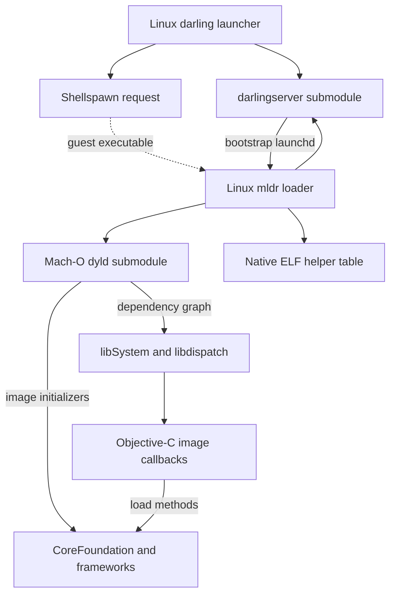

# P001 source and runtime map

## What this evidence establishes

This is a **static source inspection**, dated 2026-10-31, of integration commit [`b25035fce2cd1c038c567d34ea0797371947d95d`](https://github.com/boop-bip80/MAC-OS-EMULATION/tree/b25035fce2cd1c038c567d34ea0797371947d95d). The audited implementation baseline is [`3447ff5ab8e837ea54a13a506c60d34d77e2bd15`](https://github.com/boop-bip80/MAC-OS-EMULATION/tree/3447ff5ab8e837ea54a13a506c60d34d77e2bd15); the integration commit replaces its README with the phased plan. The prior README remains available at its [immutable source location](https://github.com/boop-bip80/MAC-OS-EMULATION/blob/3447ff5ab8e837ea54a13a506c60d34d77e2bd15/README.md).

The companion [classification register](../../../tools/compat/logic-pro/classifications.json) contains **63 source excerpts**, including **28 citations inside six pinned child repositories**, with immutable blob IDs, exact line ranges, SHA-256 hashes of excerpt bytes, required text, and classification reasoning. Child citations include the complete gitlink chain back to the audited parent. The phase verifier checks those chains against both the original and current integration trees, verifies exact child checkouts, and requires eight classification categories and six launch stages from their actual source owners. Removing all but one citation cannot pass this gate.

The original 32-citation parent-only map and its narrower acceptance are retained in Git history. This revision closes that map's previously uninspected dyld, libSystem, server and framework boundaries. The recursive inventory covers all **160 child gitlinks: 149 direct and 11 nested**. Its tracked-file and license records are complete source inventories; this curated map supplies the interpretation of critical implementation boundaries.

**No Darling runtime, Mach-O application, Logic binary, audio callback, MIDI client, graphics window, or ARM instruction translation was executed for this map.** The inventory and recovery results are separate P001 evidence. Neither a classification match nor a clean checkout qualifies application compatibility.

The map is intentionally a curated inspection of critical ownership and behavior boundaries, not an exhaustive function census. `implemented_body_unqualified` means that a source body performs work; it does not mean that its ABI, numerical result, error handling, concurrency, or supported inputs have passed tests. The recorded host and tool versions belong in [inventory.json](evidence/P001/inventory.json), so source architecture claims cannot be confused with an execution host's CPU.

## Launch path and ownership boundaries

The following diagram describes source relationships, not an execution trace. The shellspawn edge identifies a guest-launch boundary; the numbered findings below establish the requested path from `mldr` through the pinned runtime owners.

1. **The Linux launcher sets up the process environment.** `src/startup/CMakeLists.txt` builds `darling` as a native executable and requests setuid installation. In `spawnInitProcess`, the launcher calls `unshare`, forks, and executes `darlingserver` with the prefix and user/group information. This explains why a restricted build container is not automatically a suitable runtime test host. The phase does not change privileges or claim successful namespace creation. See [launcher build, lines 17–28](https://github.com/boop-bip80/MAC-OS-EMULATION/blob/b25035fce2cd1c038c567d34ea0797371947d95d/src/startup/CMakeLists.txt#L17-L28) and [server launch, lines 780–824](https://github.com/boop-bip80/MAC-OS-EMULATION/blob/b25035fce2cd1c038c567d34ea0797371947d95d/src/startup/darling.c#L780-L824). The launcher also connects to shellspawn in the prefix; the subsequent guest process path requires the server, shellspawn and execution machinery to work together, which is not demonstrated here. See [shellspawn connection](https://github.com/boop-bip80/MAC-OS-EMULATION/blob/b25035fce2cd1c038c567d34ea0797371947d95d/src/startup/darling.c#L555-L578).

2. **`mldr` bridges native Linux execution to a Mach-O image.** It is built as a host executable with `libdl`, realtime/native libraries, and generated server RPC wrappers. The loader reads Mach-O headers and maps segments through Linux memory mappings. Its `LC_LOAD_DYLINKER` case resolves a dynamic linker path and recursively loads that image. See [mldr build](https://github.com/boop-bip80/MAC-OS-EMULATION/blob/b25035fce2cd1c038c567d34ea0797371947d95d/src/startup/mldr/CMakeLists.txt#L7-L33), [segment mapping](https://github.com/boop-bip80/MAC-OS-EMULATION/blob/b25035fce2cd1c038c567d34ea0797371947d95d/src/startup/mldr/loader.c#L148-L218), and [dynamic linker command](https://github.com/boop-bip80/MAC-OS-EMULATION/blob/b25035fce2cd1c038c567d34ea0797371947d95d/src/startup/mldr/loader.c#L260-L313). These are real source paths, not a proof that all malformed inputs, relocations or modern load commands are supported.

3. **Server registration and host helpers are part of startup.** `mldr` creates an RPC socket and process-lifetime pipe, checks in with the server, prepares its startup stack, and reports dyld image and executable metadata. The stack includes an `elf_calls` pointer. That table exposes native ELF loading, allocation, threading and RPC socket functions. See [check-in](https://github.com/boop-bip80/MAC-OS-EMULATION/blob/b25035fce2cd1c038c567d34ea0797371947d95d/src/startup/mldr/mldr.c#L843-L887), [image metadata](https://github.com/boop-bip80/MAC-OS-EMULATION/blob/b25035fce2cd1c038c567d34ea0797371947d95d/src/startup/mldr/mldr.c#L265-L280), [stack data](https://github.com/boop-bip80/MAC-OS-EMULATION/blob/b25035fce2cd1c038c567d34ea0797371947d95d/src/startup/mldr/stack.c#L128-L139), and [ELF table](https://github.com/boop-bip80/MAC-OS-EMULATION/blob/b25035fce2cd1c038c567d34ea0797371947d95d/src/startup/mldr/elfcalls/elfcalls.c#L86-L129).

4. **Control transfers into the selected dyld implementation.** The x86_64 path installs the prepared stack pointer and performs an indirect jump. For an ordinary dynamic executable, `LC_LOAD_DYLINKER` supplies the dynamic linker entry. The pinned dyld build actually selects `dyld2.cpp`, `ImageLoader.cpp` and `ImageLoaderMachO.cpp`. Its main path links the executable; `ImageLoader::link` recursively loads libraries and performs rebase/binding work. See [entry transfer](https://github.com/boop-bip80/MAC-OS-EMULATION/blob/b25035fce2cd1c038c567d34ea0797371947d95d/src/startup/mldr/mldr.c#L912-L930), [selected dyld sources](https://github.com/darlinghq/darling-dyld/blob/63f667cf06d7ed59553adebb0c8d70a117135ac9/CMakeLists.txt#L84-L100), [main linking](https://github.com/darlinghq/darling-dyld/blob/63f667cf06d7ed59553adebb0c8d70a117135ac9/src/dyld2.cpp#L7252-L7264) and [recursive dependency loading](https://github.com/darlinghq/darling-dyld/blob/63f667cf06d7ed59553adebb0c8d70a117135ac9/src/ImageLoader.cpp#L505-L540).

5. **dyld orders image initialization and reaches libSystem.** `initializeMainExecutable` processes inserted roots and the main executable's dependency graph. `recursiveInitialization` visits lower dependencies before the current image, postpones upward dependencies, sends the Objective-C notification and invokes the image's initializers. `ImageLoaderMachO` invokes both `-init` routines and module initializer functions and guards the libSystem initialization boundary. The selected `libSystem.B.dylib` contains the `init.c` constructor, which initializes kernel/platform/pthread/libc/malloc/dyld/dispatch/XPC facilities with the recorded platform guards. See [initializer roots](https://github.com/darlinghq/darling-dyld/blob/63f667cf06d7ed59553adebb0c8d70a117135ac9/src/dyld2.cpp#L1741-L1761), [dependency ordering](https://github.com/darlinghq/darling-dyld/blob/63f667cf06d7ed59553adebb0c8d70a117135ac9/src/ImageLoader.cpp#L1621-L1662), [libSystem guard](https://github.com/darlinghq/darling-dyld/blob/63f667cf06d7ed59553adebb0c8d70a117135ac9/src/ImageLoaderMachO.cpp#L2310-L2334) and [libSystem sequence](https://github.com/darlinghq/darling-Libsystem/blob/08df454b6eb0df9400aa4c39839a7efd6efd2c3c/init.c#L230-L270).

6. **The server side of startup is implemented in the pinned server source.** `spawnLaunchd` supplies the socket and guest-root environment before executing mldr/vchroot with its configured init process. The RPC decoder validates call numbers, registers processes and threads, checks typed call sizes and queues calls. `Checkin::processCall` notifies process state and replies with `-ESRCH` when the thread or process is absent. These findings establish the source on both sides of mldr's check-in; they do not qualify all RPC behavior. See [bootstrap](https://github.com/darlinghq/darlingserver/blob/89751e64bc6c2082f7725061824ee0e33395b0de/src/darlingserver.cpp#L255-L275), [registration](https://github.com/darlinghq/darlingserver/blob/89751e64bc6c2082f7725061824ee0e33395b0de/src/call.cpp#L36-L77), [dispatch](https://github.com/darlinghq/darlingserver/blob/89751e64bc6c2082f7725061824ee0e33395b0de/src/call.cpp#L199-L224) and [check-in reply](https://github.com/darlinghq/darlingserver/blob/89751e64bc6c2082f7725061824ee0e33395b0de/src/call.cpp#L292-L310).

7. **Objective-C and CoreFoundation have concrete initialization wiring.** libSystem calls `libdispatch_init`; the pinned dispatch configuration selects Objective-C support and compiles `object.m`. Dispatch's queue initializer calls `_os_object_init`, whose Objective-C body calls `_objc_init`. That function registers dyld map/load/unmap callbacks; `load_images` prepares and invokes Objective-C `+load` methods. CoreFoundation is built with `DEPLOYMENT_TARGET_MACOSX=1` and explicitly linked with `-init,___CFInitialize`; its initializer sets up type registrations, Objective-C bridges and collection instances. The Linux-only constructor attribute in its portable source is not the evidence for Darling's selected path. See [dispatch-to-object initialization](https://github.com/darlinghq/darling-libdispatch/blob/380f03c180b80d940134fb35783ddc714784a53a/src/queue.c#L7918-L7932), [object-to-Objective-C call](https://github.com/darlinghq/darling-libdispatch/blob/380f03c180b80d940134fb35783ddc714784a53a/src/object.m#L75-L85), [Objective-C callbacks](https://github.com/darlinghq/darling-objc4/blob/1a12df76d12bfc9fdfffadb290f7742763568765/runtime/objc-os.mm#L925-L952), [load methods](https://github.com/darlinghq/darling-objc4/blob/1a12df76d12bfc9fdfffadb290f7742763568765/runtime/objc-runtime-new.mm#L3213-L3234), [CoreFoundation link initialization](https://github.com/darlinghq/darling-corefoundation/blob/a3640a77410cf1825f7855172b1551ae7917c461/CMakeLists.txt#L176-L190) and [type registration](https://github.com/darlinghq/darling-corefoundation/blob/a3640a77410cf1825f7855172b1551ae7917c461/CFRuntime.c#L1011-L1030).

8. **dyld finally selects the application's entry.** After initializer processing the inspected launch path selects `LC_MAIN` with libdyld exit glue, or the legacy `LC_UNIXTHREAD` entry. This is a static algorithmic ordering, not a measured successful launch or a complete description of every conditional path. See [entry selection](https://github.com/darlinghq/darling-dyld/blob/63f667cf06d7ed59553adebb0c8d70a117135ac9/src/dyld2.cpp#L7356-L7397). A particular Logic build's dependency closure and successful execution still require the later target and runtime phases.

## Classification register

| Class | Concrete inspected source | What can be concluded |
| --- | --- | --- |
| Native Linux host | `src/startup/darling.c`, `src/startup/mldr/`, native ELF helper table | Native process setup, mapping and bridging code exists. It has not been run here. |
| Mach-O runtime component | `mldr` load-command/stack/entry code; pinned dyld dependency/initializer bodies, libSystem and Objective-C initialization | The sources implement Mach-O loading and Darwin runtime initialization. Runtime correctness is not established by inspection. |
| Implemented body, unqualified | `AudioComponentManager::instantiate`, ImageIO-to-Onyx2D forwarding, `vDSP_vsadd` | Source bodies perform meaningful operations. Their correctness and complete feature coverage are unproven. |
| Partial framework | CoreAudio, AudioToolbox, IOSurface, ImageIO | Real implementation paths coexist with missing or incorrect behavior. No whole-framework completion is implied. |
| Developer link stub | `src/frameworks/dev-stubs/AudioToolbox/` and the dev-stub component selection | A separate target exports names for development linking; it is not the audio implementation under `src/CoreAudio/`. |
| Generated-stub tooling | `tools/stub-gen-c-func` | The generator emits generic `void*`/null-returning bodies. That is directly visible in its template. |
| Generated-style stub body | Selected CoreMIDI and vDSP exports | The bodies match the placeholder form and log `STUB` before returning null. The map does not infer which historical generator created every file. |
| Recursive source availability | All 160 pinned submodules and their tracked/license manifests | Zero child contents remain unavailable in the completed recursive inventory. Curated behavioral inspection remains distinct from merely obtaining each source tree. |

For exact source excerpts and hashes, use the named evidence records in [classifications.json](../../../tools/compat/logic-pro/classifications.json). The following findings explain why these categories must remain separate:

- **CoreAudio has a zero-valued clock and a format-unit defect.** `AudioGetCurrentHostTime` returns zero. The default `mBytesPerFrame` expression multiplies channels, sample rate and sample width; including sample rate does not produce bytes per frame. These are source defects, not measured audio performance. See [clock](https://github.com/boop-bip80/MAC-OS-EMULATION/blob/b25035fce2cd1c038c567d34ea0797371947d95d/src/CoreAudio/CoreAudio/HostTime.mm#L1-L8) and [format expression](https://github.com/boop-bip80/MAC-OS-EMULATION/blob/b25035fce2cd1c038c567d34ea0797371947d95d/src/CoreAudio/CoreAudio/AudioHardwareImpl.cpp#L26-L36).
- **Audio Unit instantiation and validation have different states.** The manager resolves a bundle factory and invokes its instance's `Open` method. The asynchronous API only logs an unimplemented message, and validation unconditionally assigns `Passed`. Preserve the useful manager code, but do not use that validation result as evidence of a working plug-in. See [factory implementation](https://github.com/boop-bip80/MAC-OS-EMULATION/blob/b25035fce2cd1c038c567d34ea0797371947d95d/src/CoreAudio/AudioToolbox/AudioComponentManager.mm#L266-L320), [async gap](https://github.com/boop-bip80/MAC-OS-EMULATION/blob/b25035fce2cd1c038c567d34ea0797371947d95d/src/CoreAudio/AudioToolbox/AudioComponent.mm#L236-L251), and [validation placeholder](https://github.com/boop-bip80/MAC-OS-EMULATION/blob/b25035fce2cd1c038c567d34ea0797371947d95d/src/CoreAudio/AudioToolbox/AudioComponent.mm#L297-L301).
- **Real DSP code is not automatically correct DSP code.** The inspected `vDSP_vsadd` body contains loops, whereas adjacent transform exports return null. Its loop shape alone cannot validate scalar indexing, strides or buffer boundaries. These require native/specification-based numerical probes in the relevant phase. See [non-stub loop](https://github.com/boop-bip80/MAC-OS-EMULATION/blob/b25035fce2cd1c038c567d34ea0797371947d95d/src/frameworks/Accelerate/vecLib/vDSP/src/basic.c#L22-L36) and [transform placeholders](https://github.com/boop-bip80/MAC-OS-EMULATION/blob/b25035fce2cd1c038c567d34ea0797371947d95d/src/frameworks/Accelerate/vecLib/vDSP/src/vDSP.c#L27-L47).
- **Rendering frameworks are mixed.** ImageIO forwards several image-source operations into Onyx2D but its data-provider constructor returns nil. IOSurface forwards selected operations into its Objective-C object but `IOSurfaceCreateXPCObject` returns zero. See [ImageIO](https://github.com/boop-bip80/MAC-OS-EMULATION/blob/b25035fce2cd1c038c567d34ea0797371947d95d/src/frameworks/ImageIO/src/CGImageSource.m#L14-L43) and [IOSurface](https://github.com/boop-bip80/MAC-OS-EMULATION/blob/b25035fce2cd1c038c567d34ea0797371947d95d/src/frameworks/IOSurface/src/api.m#L28-L57).
- **A package can contain several targets with similar framework names.** Development AudioToolbox stubs and the real audio source are separate. The current selection logic suppresses installation of dev stubs when GUI is selected. P003 must verify the actual installed files and resolution paths; inspecting the guard is insufficient. See [selection guard](https://github.com/boop-bip80/MAC-OS-EMULATION/blob/b25035fce2cd1c038c567d34ea0797371947d95d/src/frameworks/CMakeLists.txt#L149-L177) and [stub bodies](https://github.com/boop-bip80/MAC-OS-EMULATION/blob/b25035fce2cd1c038c567d34ea0797371947d95d/src/frameworks/dev-stubs/AudioToolbox/src/main.m#L40-L73).

## Architecture, build limitations and next ownership

The architecture generator names x86_64 and i386 target triplets. `mldr` contains explicit aarch64 compile-time barriers in both slice selection and stack setup. This establishes an Intel-oriented baseline with unfinished ARM loader paths; it does not establish an ARM runtime or an ARM-to-x86 CPU translator. See [target generation](https://github.com/boop-bip80/MAC-OS-EMULATION/blob/b25035fce2cd1c038c567d34ea0797371947d95d/cmake/architecture.cmake#L1-L38), [slice barrier](https://github.com/boop-bip80/MAC-OS-EMULATION/blob/b25035fce2cd1c038c567d34ea0797371947d95d/src/startup/mldr/mldr.c#L397-L410), and [stack barrier](https://github.com/boop-bip80/MAC-OS-EMULATION/blob/b25035fce2cd1c038c567d34ea0797371947d95d/src/startup/mldr/mldr.c#L253-L263).

The top-level build separately recommends Clang 11, enforces an out-of-source directory, and explicitly rejects i386/i686 **hosts**. Its automatic Metal selection requires both LLVM and Vulkan; missing either turns that component off. `Setcap` is required during configuration. Python 2 is optional in automatic bytecode mode and becomes required only when bytecode compilation is enabled. These are inspected configuration conditions, not a successful build result. See [host/compiler checks](https://github.com/boop-bip80/MAC-OS-EMULATION/blob/b25035fce2cd1c038c567d34ea0797371947d95d/CMakeLists.txt#L92-L105), [Python condition](https://github.com/boop-bip80/MAC-OS-EMULATION/blob/b25035fce2cd1c038c567d34ea0797371947d95d/CMakeLists.txt#L159-L178), and [Metal/Setcap requirements](https://github.com/boop-bip80/MAC-OS-EMULATION/blob/b25035fce2cd1c038c567d34ea0797371947d95d/CMakeLists.txt#L180-L202). The actual inspection host is recorded in the campaign inventory; no host's CPU name is used as proof of guest architecture support.

| Ownership boundary | Source owner / exact next responsibility |
| --- | --- |
| Obtain pinned sources | P001's `prepare_sources.py` obtains exact recursive sources from recorded public origins for inspection. P002 has now repaired the root URLs to those same public origins and published the recursive lock; its normal-clone and independent-acceptance evidence is tracked separately under P002. No pinned commits were advanced. |
| Host process startup and loader | Parent-owned `src/startup/`, `src/startup/mldr/`, `src/vchroot/`; preserve the native/Mach-O boundary and qualify behavior with probes. |
| Server and syscall compatibility | `src/external/darlingserver/`, `src/external/xnu/`; fixes belong in their maintained child repositories, followed by published parent gitlink updates. |
| Dynamic linking and language runtimes | `src/external/dyld/`, `libsystem/`, `libdispatch/`, `objc4/`, `corefoundation/`, `foundation/`; the static startup map is now pinned-source evidence, while behavioral qualification remains required. |
| GUI and rendering | Cocotron submodule plus parent `ImageIO`, `IOSurface` and framework-selection code; Metal is another submodule boundary. |
| Audio, MIDI and numerical processing | Parent `src/CoreAudio/`, `src/frameworks/CoreMIDI/`, `src/frameworks/Accelerate/`; separate source presence, correct ABI and measured behavior. |
| Evidence and recovery | `tools/compat/logic-pro/`, P001 evidence files and README ledger; keep immutable source IDs and reviewers attached to each claim. |

**Historical P001 source:** critical dependencies used relative sibling URLs, including `../darlingserver.git`, `../darling-Libsystem.git` and `../darling-dyld.git` in the [audited `.gitmodules`](https://github.com/boop-bip80/MAC-OS-EMULATION/blob/b25035fce2cd1c038c567d34ea0797371947d95d/.gitmodules#L379-L393). P001 records that original blob and its fork-relative resolution independently of the public upstream retrieval origins; it did not alter either source or pins. **Current P002 source:** those 149 direct declarations now use exact public `https://github.com/darlinghq/…` origins. Their URL-only transformation is separately pinned and checked in the `submodule-declarations` record's `current_reaudit` fields; its original P001 blob, excerpt and source assertions remain intact. Descendant relative URLs resolve against the actual public parent origin. The original audited root commit/tree also exist upstream at `darlinghq/darling`.

P001 makes the source baseline recoverable and its limits inspectable. P002's ordinary-clone and lock results are separate from that historical audit; the README's current gate and independent-review record alone determine whether the project can advance to P003. This source map does not claim a Darling build or Logic runtime result.
